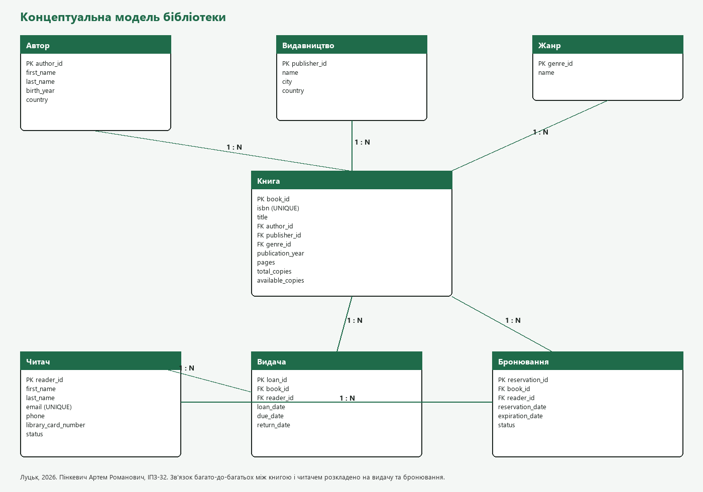
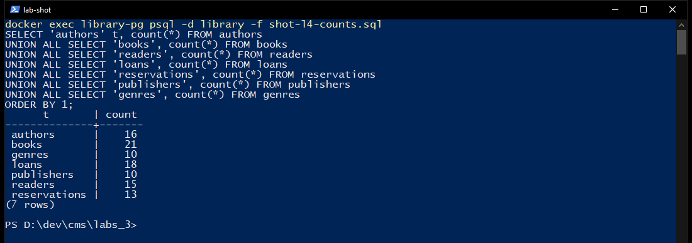
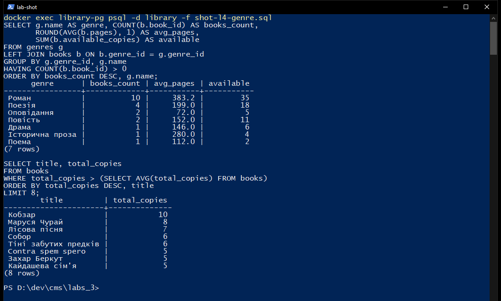
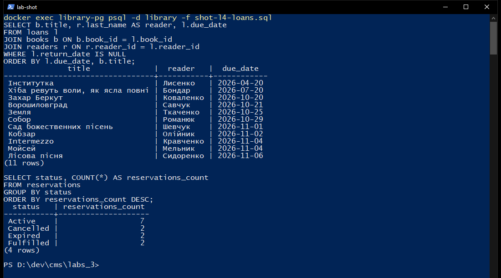
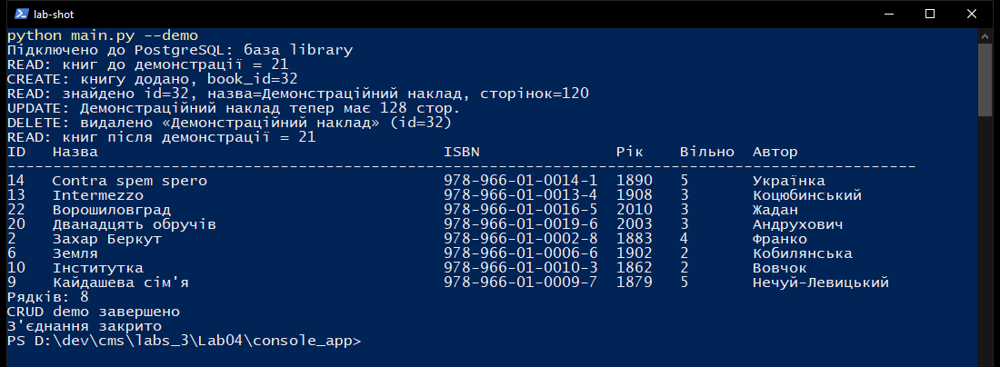
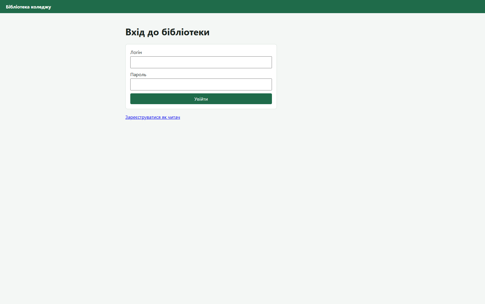
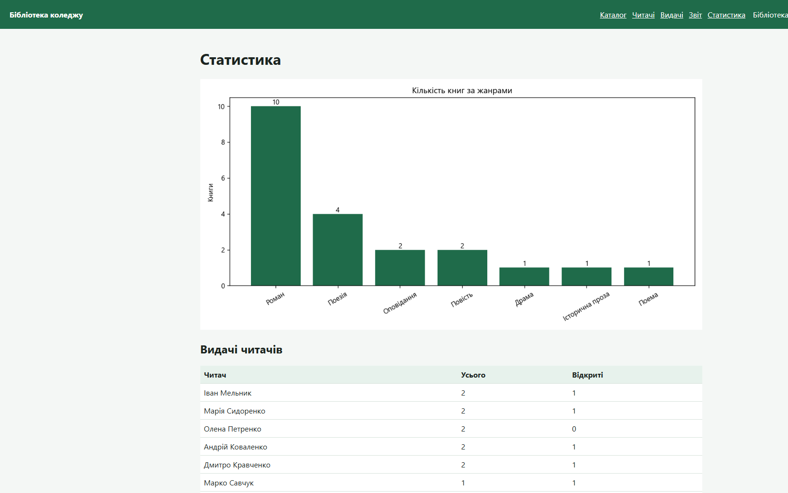

# Звіт з лабораторної роботи №4

**Тема:** Реляційна база і застосунок бібліотеки  
**Виконав:** Пінкевич Артем Романович  
**Група:** ІПЗ-32  
**Навчальний заклад:** Волинський фаховий коледж Національного університету харчових технологій  
**Місто:** Луцьк, 2026  
**Предметна область:** електронна бібліотека  
**Рівень:** 3 (високий)

## Мета роботи

Спроєктувати нормалізовану базу бібліотеки, наповнити її, написати запити, консольний CRUD і вебзастосунок Flask з ролями, журналом, звітом, пошуком, діаграмою, JSON API, резервною копією і перевіркою даних на клієнті та на сервері.

База та сама, що в лабораторній 3: контейнер `library-pg`, PostgreSQL 16.15, база `library`, користувач `postgres`, пароль `postgres`, порт 5432. Файл `docker-compose.yml` описує цей контейнер і том `library_pg_data`. Другий контейнер не піднімався.

## Предметна область і концептуальна модель

Бібліотека обліковує авторів, видавництва, жанри, книги, читачів, видачі та бронювання. Книга має одного основного автора, одне видавництво і один жанр. Зв'язок «багато читачів - багато книг» розкладено на видачу і бронювання.

Логічна схема і обґрунтування 3НФ: [docs/logical_schema.md](docs/logical_schema.md). Неключові атрибути залежать від повного первинного ключа своєї таблиці. Назва жанру і видавництва не дублюються в `books`.

## Дані після лабораторної 4

Скрипт `database/02_insert_data.sql` додав Жадана, Андруховича, Забужко і п'ять їхніх книжок, двох читачів, видачу «Ворошиловграда» і бронювання «Музею покинутих секретів». Повторний запуск не створює дублікатів: стоять `ON CONFLICT` і `NOT EXISTS`.

| Таблиця | Рядків |
| ---: | ---: |
| authors | 16 |
| books | 21 |
| readers | 14 |
| loans | 17 |
| reservations | 12 |
| publishers | 10 |
| genres | 10 |

Таблиця вище це стан одразу після наповнення лабораторної 4. На знімку вже пізніший стан тієї самої бази: читачів 15, видач 18, бронювань 13. Книг як і раніше 21.

## Запити

Файл `database/queries.sql` виконано в `psql`. Нижче ті результати, які повернув сервер.

Книги з 1900 року відсортовано за роком. З'єднання з авторами і видавництвами дало 21 рядок, усі країни авторів у вибірці - Україна.

Агрегат за жанром:

| Жанр | Книг | Середня кількість сторінок | Доступно |
| --- | ---: | ---: | ---: |
| Роман | 10 | 383.2 | 35 |
| Поезія | 4 | 199.0 | 18 |
| Оповідання | 2 | 72.0 | 5 |
| Повість | 2 | 152.0 | 11 |
| Драма | 1 | 146.0 | 6 |
| Історична проза | 1 | 280.0 | 4 |
| Поема | 1 | 112.0 | 2 |

Підзапит `total_copies > (SELECT AVG(total_copies) FROM books)` повернув 8 книг. Перша - «Кобзар», 10 примірників.

Відкритих видач на момент запиту було 11. Три з них прострочені: «Інститутка» (Лисенко, 2026-04-20), «Хіба ревуть воли, як ясла повні» (Бондар, 2026-07-20), «Захар Беркут» (Коваленко, 2026-10-20). Найбільше видач у Коваленка, Кравченка і Мельника - по 2. Бронювання: Active 7, Expired 2, Fulfilled 2, Cancelled 1. За місяцями найбільше видач у 2026-10: 9.

## Процедури, тригери, представлення, індекси

У базі вже були `issue_loan`, `return_loan` і `extend_loan`. Лабораторна 4 містить їхній текст у `database/03_create_procedures.sql` (`CREATE OR REPLACE`), тож логіка лишається однією.

Додано тригер `books_touch_updated_at` (ставить `updated_at` перед `UPDATE`) і `loans_audit_trigger` (журнал видач). Перевірковий `UPDATE loans SET due_date = due_date` записав рядок в `audit_log`. У лабораторній 5 цей тригер замінено повним журналом, щоб одна зміна не писалася двічі.

Представлення `v_books_catalog` з'єднує книгу, автора, видавництво і жанр. `v_active_loans` лишає лише відкриті видачі і позначає прострочення.

Індекси: `idx_books_author_id`, `idx_books_title`, `idx_books_publication_year`, `idx_loans_book_id`, `idx_loans_reader_id`, `idx_readers_email`, `idx_readers_status`, `idx_reservations_status`, `idx_activity_log_created` та індекси зовнішніх ключів зі схеми. Список знято з `pg_indexes`.

## Консольний CRUD

`console_app/main.py --demo` підключився до `library` і виконав цикл:

- книг до демонстрації: 21
- створено «Демонстраційний наклад», `book_id` 24, ISBN `978-966-77-0001-1`
- прочитано рядок: 120 сторінок
- оновлено до 128 сторінок
- рядок видалено
- книг після демонстрації знову 21

Запити параметризовані (`%s`), помилка відкочує транзакцію з'єднання.

## Вебзастосунок

Flask слухає `http://127.0.0.1:5055` (`web_app/app.py`). Шаблони: вхід, реєстрація, головна, каталог, форма книги, читачі, видачі, статистика, журнал. Стилі в `static/style.css`. Перевірка ISBN, року, сторінок і тиражу є в `static/validate.js` і повторюється в `validate_book()` на сервері. Сортування береться лише зі списку `title` / `year` / `copies`, напрямок - лише `ASC` або `DESC`.

Облікові записи, хеші згенеровано Werkzeug:

| Логін | Пароль | Роль |
| --- | --- | --- |
| admin | admin123 | admin |
| librarian | lib123 | librarian |
| reader | read123 | reader |

Реєстрація створює лише роль `reader`. Під час перевірки створено логін `student32`.

Сторінку входу відкрито в браузері.

Той самий запущений сервер перевірено HTTP-запитами:

- пароль `wrong` для `reader` повернув **401** і текст «Невірний логін або пароль»;
- `reader` / `read123` відкрив головну «Облік бібліотеки»;
- `GET /books/add` від читача повернув каталог із повідомленням «Недостатньо прав для цієї дії»;
- пошук `q=Кобзар`, сортування за роком за спаданням повернув каталог із «Кобзарем»;
- бібліотекар надіслав ISBN `123` і отримав **400** та помилку формату ISBN;
- книга «Веб-перевірка», ISBN `978-966-88-0001-1`, збереглася (`book_id` 25), після перевірки її видалено, у каталозі знову 21 книга;
- `GET /stats` віддав сторінку з `genres.png`;
- `GET /report` повернув `catalog_report.html`, 3877 байт після повторного формування вже без тестової книги;
- `GET /api/books` без ключа повернув **401** `Invalid API key`;
- з заголовком `X-API-Key: library-lab-key` той самий маршрут повернув `success: true` і 22 книги, доки тестова книга ще була в таблиці;
- `POST /api/loans` з `book_id` 14, `reader_id` 3, `days` 10 повернув **201**, `loan_id` 18, «Книгу видано»; видачу одразу прийнято через `return_loan(18)`, залишилося 11 відкритих видач;
- журнал адміністратора містить і `audit_log`, і `activity_log` (є `LOGIN`, `INSERT`, `DELETE`).

Діаграму будує `charts.py` (matplotlib, шрифт Segoe UI) і зберігає у `web_app/static/charts/genres.png`.

HTML-звіт лежить у `reports/catalog_report.html`. Резервна копія: `scripts/backup_db.ps1` викликає `pg_dump` усередині контейнера. Фактичний файл `backups/library-20261021-211750.sql`, **3 552 517 байт**.

## Висновки

Схема бібліотеки в третій нормальній формі з'єднана з консольним CRUD і Flask. Ролі обмежують зміну даних, сервер не приймає зламаний ISBN навіть якщо клієнтську перевірку обійти, пошук фільтрує і сортує каталог, статистика малює діаграму, API віддає JSON лише з ключем, а `pg_dump` знімає базу з контейнера. Бізнес-операції видачі лишаються в процедурах PostgreSQL, а не в розкиданих запитах клієнта.
