# Звіт з лабораторної роботи №6

**Тема:** Робота з СУБД MongoDB та реалізація операцій  
**Виконав:** Пінкевич Артем Романович  
**Група:** ІПЗ-32  
**Місце і рік:** Луцьк, 2026  
**Рівень:** 3

## Мета роботи

Опанувати документну базу MongoDB: створити базу `library`, виконати CRUD, індексування, агрегацію, текстовий і геопросторовий пошук, валідацію JSON Schema, історію версій документів, реплікацію та резервне копіювання.

## Середовище

MongoDB запущено в Docker, без автентифікації. Образ `mongo:7`, фактична версія сервера `7.0.45`. Replica set `rs0` складається з трьох контейнерів в мережі `library-net`. На хост опубліковано лише `library-mongo` і порт `27017`. Вузли `library-mongo-2` та `library-mongo-3` доступні всередині мережі Docker.

```text
executed_at: 2026-10-21T17:14:18.104Z
mongodb: 7.0.45
db: library
me: library-mongo:27017
setName: rs0
isWritablePrimary: true
hosts: library-mongo:27017, library-mongo-2:27017, library-mongo-3:27017
```

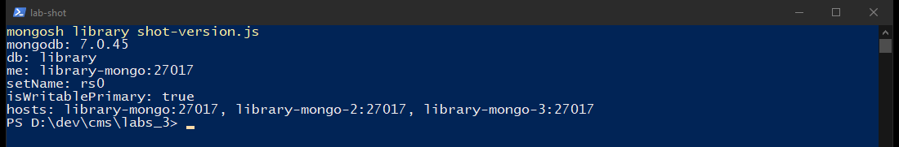

Скрипт виконання: `scripts/lab06.js`. Повний вивід mongosh збережено в `output/lab06-mongosh.txt`. Рядок завершення: `LAB06_OK`, `SHELL_EXIT:0`.

## Рівень 1. Дані, CRUD, індекси

База `library`. Колекції `books`, `authors`, `users` створено з валідатором `$jsonSchema`. У документах є вкладені об'єкти (`contact`, `profile`, `address`, `location`, `ratings`) і масиви (`genres`, `notable_works`, `borrowed_books`).

Вставку зроблено двома способами: `insertMany` і `insertOne`. Після початкового завантаження лічильники такі: `books=10`, `authors=10`, `users=10`.

Автори: Тарас Шевченко; Леся Українка; Іван Франко; Михайло Коцюбинський; Панас Мирний; Григорій Квітка-Основ'яненко; Василь Стефаник; Іван Нечуй-Левицький; Ольга Кобилянська; Марко Вовчок.

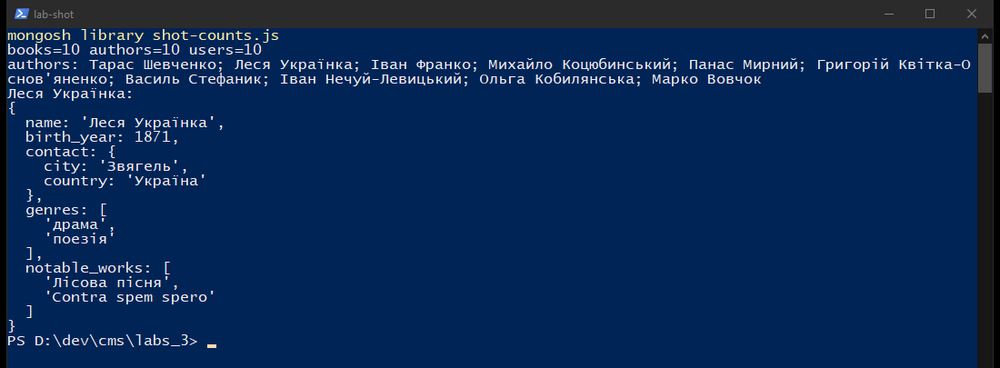

### CRUD

| Операція | Результат |
|---|---|
| `find` автора «Іван Франко» | 2 документи: «Захар Беркут», «Каменярі» |
| `pages > 100` | 5 книг |
| проєкція доступних книг | 8 документів до подальшого оновлення «Кобзаря» |
| `sort` + `limit 5` | 1911 «Лісова пісня», 1911 «Тіні забутих предків», 1909 «Intermezzo», 1900 «Камінний хрест», 1883 «Захар Беркут» |
| `updateOne` «Кобзар» | `matched=1`, `modified=1`, `available=false` |
| `$push` рейтингу «Лісова пісня» | 1 оцінка, `score=5`, користувач `ivan_petrov` |
| `updateMany` для року `< 1900` | `matched=6`, `modified=6`, поле `category` |
| `$inc` `borrowed_count` | «Тіні забутих предків»: `borrowed_count=1` |
| `$unset temporary_note` | `modified=1`, поле після цього відсутнє |
| `replaceOne` + `deleteMany` тимчасових книг | вставлено 3 тимчасові документи, видалено 3 |
| `deleteOne` тимчасового автора і користувача `old_user` | по 1 видаленню |

Після CRUD знову `books=10`, `authors=10`, `users=10`.

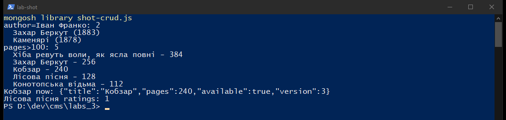

### Індекси і план виконання

Три індекси колекції `books`: `author_1`, `title_1`, унікальний `isbn_1`.

До індексу запит `{ author: "Іван Франко" }` ішов через `COLLSCAN`: переглянуто 10 документів, повернуто 2, `executionTimeMillis=0`. Після `author_1` план став `FETCH -> IXSCAN(author_1)`: переглянуто 2 документи і 2 ключі.

На 10 документах час майже не відрізняється, тому окремо виміряно колекцію `books_bench` на 15000 документів (150 з них мають автора «Іван Франко»). Після вимірювання колекцію видалено (`exists=false`).

| Стан | План | Документів переглянуто | `executionTimeMillis` | 30 повторів `find` |
|---|---|---|---|---|
| без індексу | `COLLSCAN` | 15000 | 5 | 233 мс |
| з `author_1` | `IXSCAN` | 150 | 1 | 66 мс |

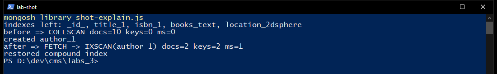

## Рівень 2. Запити, агрегація, lookup, представлення

### Оператори

- `$and` (рік `>= 1800`, сторінки `> 100`, `available: true`): 4 книги. «Кобзар», «Лісова пісня», «Хіба ревуть воли, як ясла повні», «Конотопська відьма». «Кобзар» знову доступний після оновлення в історії версій.
- `$or` (Шевченко або жанр «поезія»): 2 книги. «Кобзар», «Каменярі».
- `$in` жанрів «драма» і «новела»: 2 книги. «Лісова пісня», «Камінний хрест».
- `$regex` `/пісня|хрест/i`: 2 книги. «Камінний хрест», «Лісова пісня».

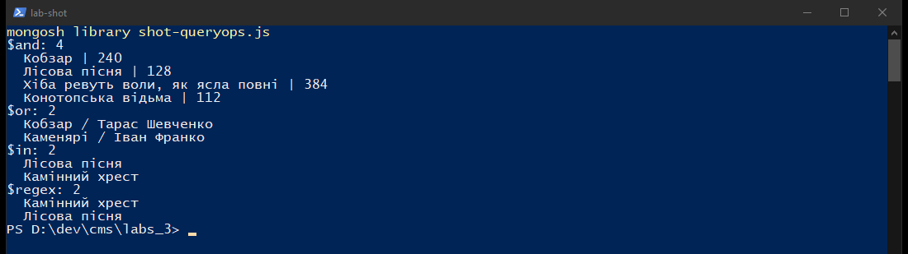

### Агрегація

Кількість книг за жанрами після `$unwind`: повість 4, реалізм 3, романтизм 3, поезія 2, роман 2, решта жанрів по 1.

Середня кількість сторінок за автором: Панас Мирний 384 (1 книга), Тарас Шевченко 238 (1), Іван Франко 160 (2), Леся Українка 128 (1), Григорій Квітка-Основ'яненко 104 (2), Михайло Коцюбинський 84 (2), Василь Стефаник 48 (1). У трьох авторів колекції `authors` немає книг у `books`, тому вони в це групування не входять.

За століттям: XIX століття - 7 книг і 5 авторів, XX століття - 3 книги і 2 автори.

Топ користувачів за розміром масиву `borrowed_books`: `dmytro_bondar` (suspended) 2, `ivan_petrov` 2, `vasyl_tkach` 2, `anna_melnyk` 1, `maria_kovalenko` 1.

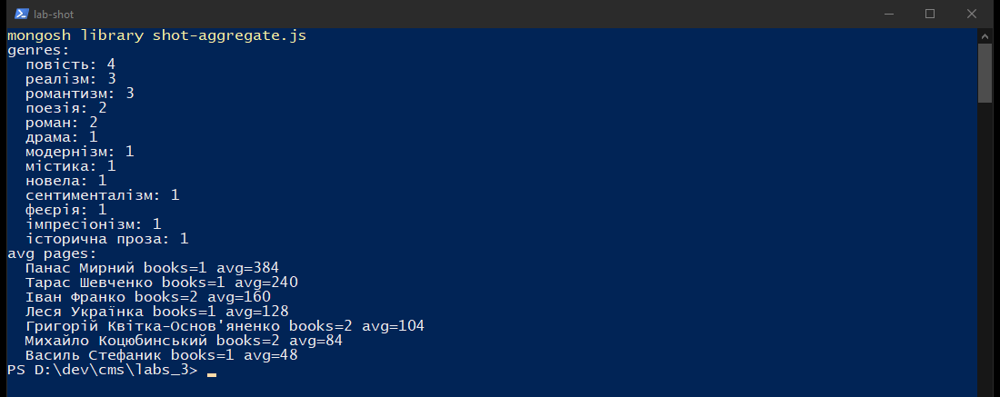

### Складений індекс, `$lookup`, view

Складений індекс `author_1_publication_year_-1`. Запит за автором і роком використав його: `IXSCAN(author_1_publication_year_-1)`, 2 ключі, 2 документи.

Поле `author_id` проставлено всім 10 книгам. `$lookup` у `authors` повернув ім'я, рік народження і місто. Фрагмент результату: «Маруся» - Григорій Квітка-Основ'яненко, 1778, Харків; «Кобзар» - Тарас Шевченко, 1814, Моринці.

Представлення `available_books` одразу після CRUD містило 7 книг, бо «Кобзар» на той момент був позначений як виданий. Представлення `books_with_authors` містить 10 документів. Доступні книги до 1900 року в view: «Хіба ревуть воли, як ясла повні» (1880), «Каменярі» (1878), «Конотопська відьма» (1837).

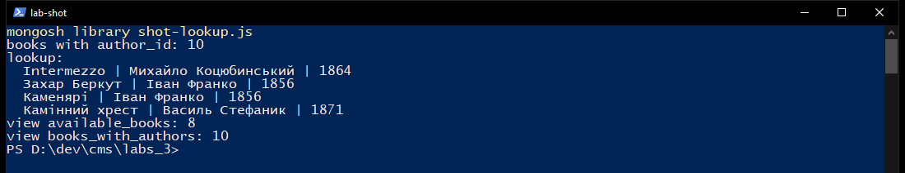

### Текстовий індекс

Індекс `books_text` на полях `title`, `description`, `uk_tokens`, `default_language: "none"`. Окремого стемінгу української мови у вбудованому text-індексі немає, тому поруч збережено нормалізовані токени.

| Запит | Збігів | Що знайдено |
|---|---|---|
| `кохання` | 3 | «Маруся» 3.0000, «Intermezzo» 2.9167, «Тіні забутих предків» 2.9167 |
| `Карпатах` | 1 | «Тіні забутих предків» 2.9167 |
| `Карпати` без стемінгу | 0 | точної словоформи в тексті немає |
| стеми `карпат коханн` | 3 | «Тіні забутих предків» 6.6000, «Маруся» 3.3000, «Intermezzo» 3.3000 |

Токени «Тіней забутих предків»: `тіні забутих предк поетичн повість про коханн карпат романтизм модернізм`.

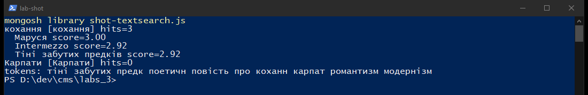

## Рівень 3

### JSON Schema

`collMod` для `books` завершився з `ok=1`. Валідація `strict`, дія `error`. Некоректні вставки відхилено:

- рік `3000`: код `121`, `Document failed validation`;
- `available: "yes"`: код `121`;
- ISBN `NOT-ISBN`: код `121`;
- повторний ISBN «Кобзаря»: код `11000`.

Коректний тимчасовий документ вставлено і одразу видалено (`deleted=1`), тож у колекції лишилось 10 книг.

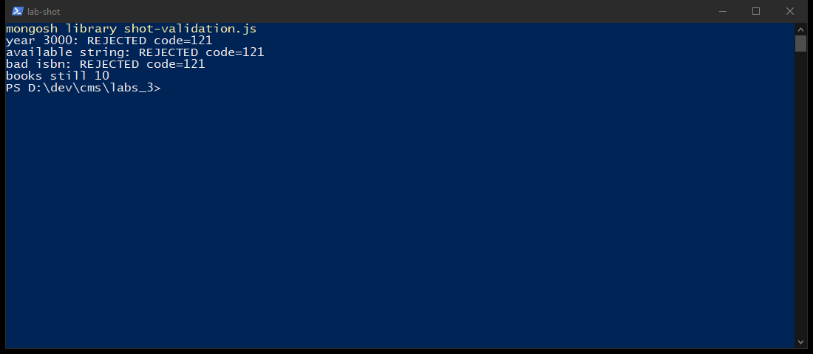

### Геоіндекс

Індекс `location_2dsphere`. Точка відліку - центр Луцька `[25.3254, 50.7472]`.

`$geoNear` з `maxDistance: 5000` повернув 8 луцьких примірників. Найближчі: «Кобзар» 0 м, «Конотопська відьма» 271.5 м, «Маруся» 751.9 м, «Лісова пісня» 1035.9 м. Найдальший у цьому радіусі - «Тіні забутих предків», 2298 м.

`$near` з радіусом 150 км додав «Каменярі» (Ковель) та «Intermezzo» (Рівне). Разом 10 книг.

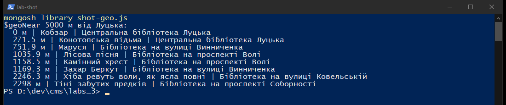

### Історія версій

Оновлення «Кобзаря» пише попередній знімок у `book_history`, потім збільшує `version`.

1. Версія 1 у історії: 238 сторінок, `available=false` (стан після CRUD).
2. Версія 2 у історії: 240 сторінок, `available=true`.
3. Поточний документ: версія 3, 240 сторінок, доступний, опис доповнено згадкою фонду бібліотеки Луцька.

Після повернення «Кобзаря» у фонд view `available_books` містить уже 8 документів. Це зафіксовано в підсумковому лічильнику.

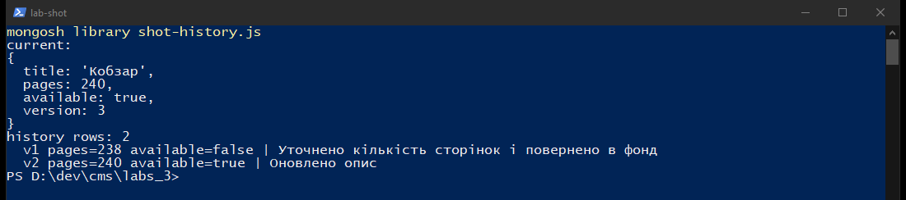

### Реплікація

`rs.status`: `set=rs0`, `myState=1`.

| Вузол | Стан | health |
|---|---|---|
| `library-mongo:27017` | PRIMARY, self | 1 |
| `library-mongo-2:27017` | SECONDARY | 1 |
| `library-mongo-3:27017` | SECONDARY | 1 |

Читання з вторинних вузлів з `readPreference=secondary` дало однаковий результат: `library.books=10`, `authors=10`, `users=10`, `book_history=2`.

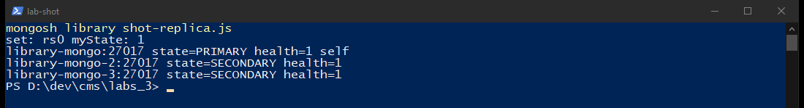

### mongodump

Команда всередині контейнера:

```bash
mongodump --uri="mongodb://127.0.0.1:27017/?directConnection=true" --db=library --out=/tmp/library_backup
```

Фактичний вивід:

```text
done dumping `library.authors` (10 documents)
done dumping `library.users` (10 documents)
done dumping `library.book_history` (2 documents)
done dumping `library.books` (10 documents)
DUMP_OK
```

Копія лежить у `backup/library_backup/library/`. Розміри: `books.bson` 7758 байт, `authors.bson` 3840, `users.bson` 4082, `book_history.bson` 1745. Поруч збережено metadata представлень `available_books` і `books_with_authors`.

### Підсумок об'єктів

```text
books=10 authors=10 users=10 history=2 available_view=8
```

Індекси `books`: `_id_`, `author_1`, `title_1`, `isbn_1` (unique), `author_1_publication_year_-1`, `books_text`, `location_2dsphere`.

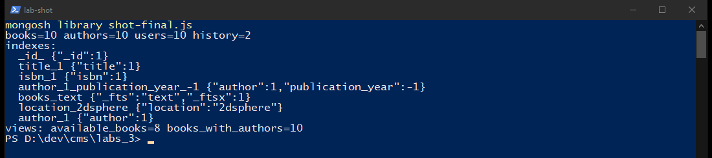

## Порівняння з реляційною схемою бібліотеки

Предметна область - облік книг, авторів і читачів.

У реляційній схемі це окремі таблиці `authors`, `books`, `genres`, `book_genres`, `users`, `borrowed_books`, `ratings`, `book_history`. Жанр і рейтинг винесені в зв'язані таблиці, бо в SQL масив не є звичайною колонкою. Запит «книга разом з автором і жанрами» потребує кількох JOIN.

У MongoDB книга є одним документом: авторське ім'я, масив жанрів, координати філії і масив оцінок лежать поруч. Зв'язок з повною карткою автора зроблено через `author_id` і `$lookup`, бо біографія автора використовується і окремо. Історія змін винесена в `book_history`, щоб не роздувати поточний документ.

| Аспект | Реляційна схема | Ця база `library` |
|---|---|---|
| Зберігання жанрів | таблиця зв'язку | масив `genres` |
| Картка книги | JOIN кількох таблиць | один `find` |
| Оновлення біографії автора | один рядок `authors` | документ `authors`; у книзі дублюється лише ім'я |
| Контроль форми | `NOT NULL`, `CHECK`, зовнішні ключі | `$jsonSchema` і унікальний ISBN |
| Геопошук філій | розширення типу PostGIS | `2dsphere` |
| Масштаб цього набору | 10 книг не потребують шардингу | те саме; індекс помітний уже на 15000 службових документів |

Для цієї бібліотеки документ зручний там, де сторінка книги читається цілком. Окремі колекції лишені для авторів, читачів та історії, бо ці сутності живуть власним життям.

## Відповіді на контрольні запитання

1. Реляційна база тримає нормалізовані рядки і зв'язки ключами. Документна база тримає близькі до екранної форми BSON-документи. SQL доречний для строгої звітності з багатьма зв'язками, MongoDB - для карток із вкладеними списками.
2. BSON - двійкове подання документів з типами на кшталт `ObjectId`, `Date`, `Int32`. JSON цих типів сам по собі не розрізняє.
3. Денормалізація зберігає частину даних повторно, щоб читати їх без з'єднання. Виграш - просте читання. Ціна - узгодження копій під час оновлення.
4. Агрегація йде стадіями: `$match` відбирає, `$unwind` розгортає масив, `$group` рахує, `$sort` і `$limit` впорядковують. У роботі так пораховано жанри, середні сторінки і століття.
5. Індекс тримає ключі окремо від документів. На стенді `COLLSCAN` переглянув 15000 документів, `IXSCAN` - 150. Використано звичайний, унікальний, складений, текстовий і `2dsphere` індекси.
6. `updateOne` змінює перший збіг, `updateMany` - усі, `replaceOne` підміняє документ цілком, крім `_id`. У роботі всі три операції виконані на тимчасових або основних книгах.
7. Валідація `$jsonSchema` перевіряє типи, межі й шаблон ISBN під час запису. Невалідний рік повернув код 121.
8. Вкладений документ доречний для рейтингу книги. Посилання `author_id` доречне для автора, якого читають і окремо. Обидва способи в базі є.
9. Текстовий індекс шукає слова і повертає `textScore`. Для української мови вбудований стемер відсутній, тому додано поле нормалізованих токенів.
10. Реплікація тримає копії набору `rs0` на трьох вузлах. Шардинг тут не налаштовувався: набір навчальний і вміщується на одному primary.

## Висновок

Базу `library` зібрано в MongoDB 7.0.45. Десять книг, десять авторів і десять читачів пройшли CRUD, три базові індекси підтверджені планом виконання, агрегація і `$lookup` пораховані на цих самих документах. JSON Schema відхиляє хибні записи, геоіндекс відсіює Ковель і Рівне за межею 5 км, історія «Кобзаря» зберігає дві попередні версії, `mongodump` зняв 10 + 10 + 10 документів і 2 версії, а вторинні вузли replica set містять ті самі лічильники.

**Самооцінка:** 5/5
