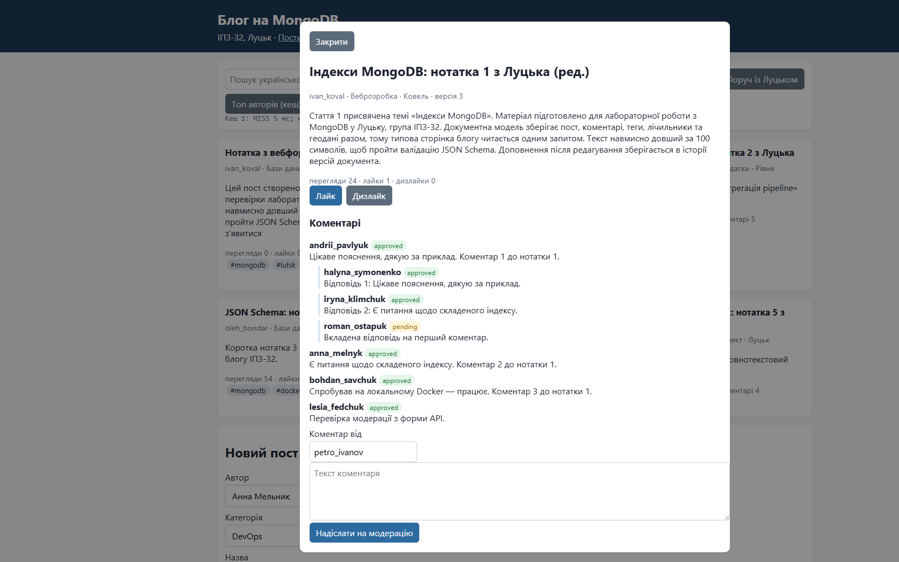
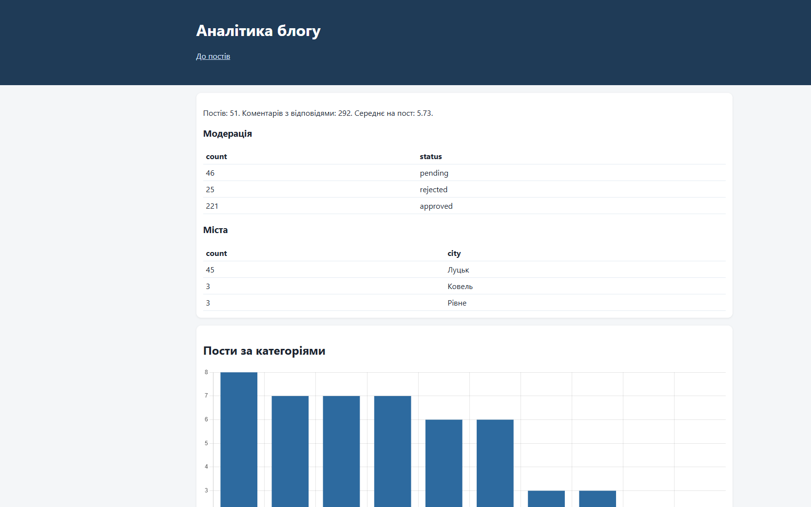
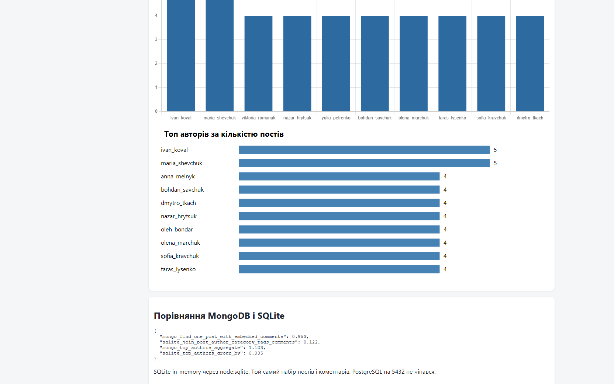
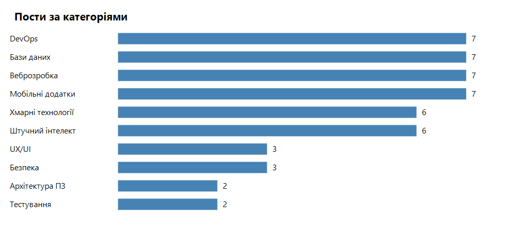
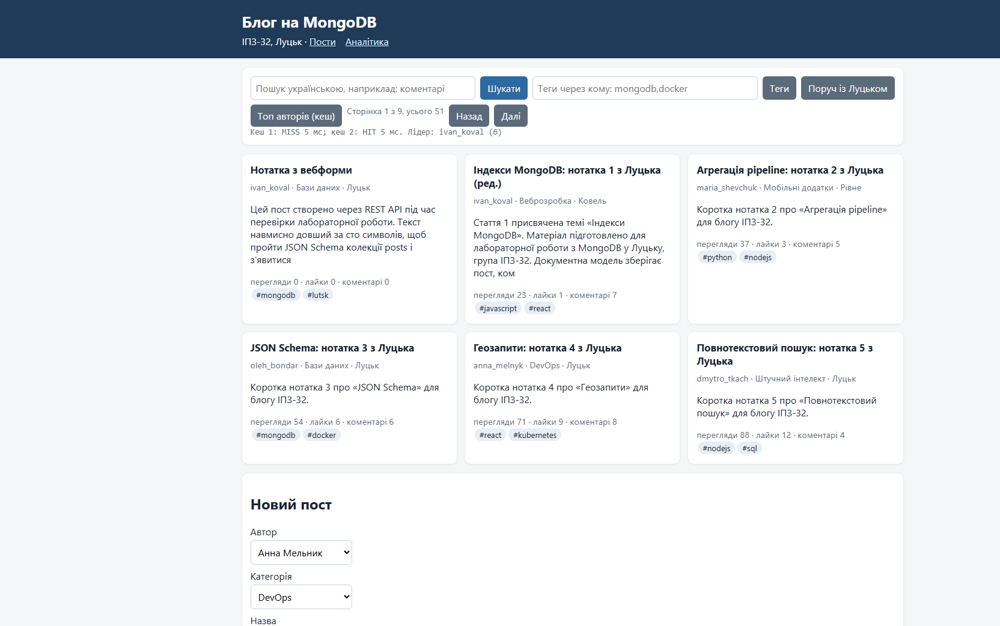

# Звіт з лабораторної роботи №7

**Тема:** Повний цикл розробки NoSQL-застосунку з інтеграцією  
**Виконав:** Пінкевич Артем Романович  
**Група:** ІПЗ-32  
**Місце і рік:** Луцьк, 2026  
**Рівень:** 3

## Мета роботи

Спроєктувати документну схему блогу, наповнити її, побудувати агрегації та індекси і підняти вебзастосунок з REST API, модерацією, геопошуком, історією редагувань, сповіщеннями, аналітикою і кешем.

## Середовище

Та сама MongoDB, що й у лабораторній 6: контейнер `library-mongo`, порт `27017`, replica set `rs0`, без автентифікації. База блогу називається `blog` і лежить поруч із `library`.

Сервер: Node.js, Express, драйвер MongoDB. Адреса: `http://localhost:3017`. Запуск: `node server.js` у теці `labs_3/Lab07_Blog`. Наповнення: `node seed.js`.

Перевірка `GET /api/health` одразу після наповнення:

```json
{"ok":true,"db":"blog","posts":50,"users":20,"categories":10,"primary":"library-mongo:27017","setName":"rs0"}
```

## Схема

`users` - роль `admin`, `author` або `reader`, унікальні `username` і `email`, хеш пароля завдовжки 60 символів, вкладений `profile`.  
`categories` - назва, `slug`, лічильник постів.  
`posts` - автор і категорія вкладені для сторінки поста, коментарі теж вкладені. У коментаря є масив `replies` тієї самої форми. Далі в документі: теги, `statistics` (перегляди, лайки, дизлайки, кількість коментарів), `location` типу GeoJSON Point, `edit_history`, `uk_tokens`.  
`notifications` - отримувач, тип, текст, прапорець `read`.

Колекції створені з `$jsonSchema`, `validationLevel: "strict"`. Спроба вставити користувача з роллю `superuser` відхилена: код `121`, `Document failed validation`. HTTP-форма з надто короткою назвою повертає `400` і текст «Назва має містити від 3 до 200 символів».

## Наповнення

`seed.js` записав детермінований набір:

| Колекція | Кількість |
|---|---|
| `users` | 20: 1 адміністратор, 12 авторів, 7 читачів |
| `categories` | 10 |
| `posts` | 50, усі `published` |
| вузли коментарів | 290, з них відповіді вкладені в перший коментар |
| `notifications` | 223 |

Агрегація коментарів: `total_posts=50`, `total_comments=290`, `max_comments=8`, `avg_comments_per_post=5.8`.

Модерація по дереву коментарів: `approved` 220, `pending` 45, `rejected` 25. Сума 290.

Топ авторів за кількістю постів (сортування за кількістю, потім за ім'ям): `ivan_koval` і `maria_shevchuk` по 5 постів, далі вісім авторів по 4. Ще двоє авторів також мають по 4 пости і в десятку за цим сортуванням не входять.

Категорії: «Веброзробка», «Мобільні додатки», «Бази даних» і «DevOps» по 7 постів; «Штучний інтелект» і «Хмарні технології» по 6; «Безпека» і «UX/UI» по 3; «Архітектура ПЗ» і «Тестування» по 2.

Пости з обома тегами `mongodb` і `docker`: 5. Усі п'ять мають назву на тему «JSON Schema» (нотатки 3, 13, 23, 33, 43).

## Індекси

До індексу пошук `{ "author.username": "ivan_koval" }` ішов через `COLLSCAN`: переглянуто 50 документів, повернуто 5. Після індексу `author_username` план `FETCH -> IXSCAN(author_username)`: переглянуто 5 документів і 5 ключів. `executionTimeMillis` в обох випадках 0, бо колекція мала.

Інші індекси постів: `slug_1` (unique), `author_date`, `category_date`, `category_slug`, `published_at_-1`, `tags_1`, текстовий `posts_text` (`default_language: "none"`), `location_2dsphere`.

## Рівень 2 у вебзастосунку

Сторінка `http://localhost:3017/` читає `GET /api/posts`. Пагінація зроблена агрегацією `$facet`: сторінка і загальна кількість приходять разом. Після наповнення перша сторінка мала `page=1`, `limit=6`, `total=50`. Перший заголовок другої сторінки: «Кешування запитів: нотатка 7 з Луцька».


На знімку вже видно пізніший стан після перевірки API: «Сторінка 1 з 9, усього 51» і новий пост «Нотатка з вебформи».

Текстовий пошук нормалізує українські словоформи тим самим спрощеним стемером, що й у лабораторній 6. Запит `коментарі Луцьку` перетворено на `коментар луцьк` і повернув 15 документів (межа вибірки).

Геозапит від центру Луцька `[25.3254, 50.7472]` у радіусі 15 км повернув 44 пости, усі з містом «Луцьк». Ковель і Рівне в цей радіус не потрапили.

Лічильник переглядів росте в `GET /api/posts/:id`. Для нотатки 1 два послідовні виклики дали `views` 21, потім 22 (початкове значення після seed для цього поста було 20, кожен виклик додає 1 і повертає вже збільшене число). Повторний лайк від `petro_ivanov` не збільшив лічильник удруге: перший виклик `updated: true`, `likes: 1`; другий `updated: false`, `likes: 1`.

Новий коментар отримує статус `pending`. Його модерація через `PATCH` змінила статус на `approved` (`modified: 1`).

## Рівень 3

### Історія редагування

`PUT /api/posts/:id` зберігає попередні заголовок і текст у `edit_history`. Нотатка 1 після редагування має `version: 3` і 2 записи історії: один був у seed, другий додало API. Заголовок на сторінці: «Індекси MongoDB: нотатка 1 з Луцька (ред.)».

### Вкладені відповіді і сповіщення

У картці поста видно коментар `andrii_pavlyuk` і відповіді `halyna_symonenko` та `iryna_klimchuk`. Відповідь, надіслана через API від `roman_ostapuk`, має статус `pending`. Коментар `lesia_fedchuk` після модерації має статус `approved`.



Сповіщення автору `ivan_koval`: `unread=12`. Останнє повідомлення: «roman_ostapuk відповів у коментарях до «Індекси MongoDB: нотатка 1 з Луцька»».

### Геодані

Поле `location` є в кожному пості. Після додавання ще одного луцького поста розподіл міст такий: Луцьк 45, Рівне 3, Ковель 3. Разом 51.

### Аналітика

`GET /api/analytics` після перевірки API: 51 пост, 292 коментарі з відповідями, середнє 5.73. Модерація: `approved` 221, `rejected` 25, `pending` 46. Сума 292: до 290 вузлів seed додано один коментар і одну відповідь.

Діаграма на сторінці будується Chart.js з цієї відповіді. Поруч лежить PNG, згенерований з агрегації початкових 50 постів: «Бази даних», «DevOps», «Веброзробка» і «Мобільні додатки» по 7. Після створення поста через API діаграма категорій показує «Бази даних» уже з 8 постами. Кнопка кешу на головній називає лідером `ivan_koval` з 6 постами.







### REST і кеш

Маршрути сервера: стрічка і пагінація, геопошук, картка з інкрементом переглядів, створення і редагування поста, лайк і дизлайк, коментар, відповідь, модерація, пошук, категорії, користувачі, топ авторів, статистика, аналітика, сповіщення.

Кеш у пам'яті процесу тримає топ авторів 20 секунд. Перший виклик під час демонстрації: `X-Cache: MISS`, запит до бази 3 мс. Другий: `HIT`. Кнопка на сторінці після створення нового поста показала вже оновлений кеш: «Кеш 1: MISS 3 мс; кеш 2: HIT 5 мс. Лідер: ivan_koval (6)». Створення поста скидає цей ключ, тому перший виклик знову йде в базу.



Створення поста повернуло `201` і `slug: "notatka-z-vebformy"`. Наступний health: `posts: 51`, `users: 20`, `categories: 10`.

Повний протокол викликів: `output/api-demo.json`.

## Порівняння з реляційною схемою

Еквівалентна реляційна модель блогу складається з таблиць `users`, `categories`, `posts`, `comments` (відповідь тримає `parent_id`), `tags`, `post_tags`, `notifications`, `post_edits`. Сторінка поста збирається JOIN-ами. У MongoDB ця сторінка є одним документом `posts`.

PostgreSQL на порту 5432 не використовувався: порт зайнятий іншим контейнером. Той самий набір з 50 постів і 290 коментарів завантажено в SQLite в пам'яті (`node:sqlite`) і виміряно поруч із MongoDB. Для поста «Індекси MongoDB: нотатка 1 з Луцька» обидва боки порахували 5 вузлів коментарів.

Середній час одного виклику:

| Запит | MongoDB | SQLite в пам'яті |
|---|---|---|
| прочитати пост разом із коментарями | 0.953 мс (300 повторів) | 0.122 мс (300 повторів) |
| топ авторів | 1.123 мс (100 повторів) | 0.035 мс (100 повторів) |

На 50 документах SQLite у пам'яті швидший. Обсяг занадто малий, щоб документна модель виграла часом. Її практичний виграш на цьому блозі інший: сторінка, коментарі, теги і лічильники приходять одним запитом, а реляційний JOIN легко завищує `COUNT`, якщо теги і коментарі з'єднати без `COUNT(DISTINCT)`. Саме так перша чернетка SQL порахувала 10 коментарів замість 5, доки агрегат не зробили за `DISTINCT`.

## Відповіді на контрольні запитання

1. Схему проєктують від типового читання. Сторінка поста читається часто, тому коментарі вкладені. Користувач і категорія існують окремо, а в пості лежить коротка копія імені.
2. Вкладення доречне для коментарів цього поста. Посилання доречне для користувача, якого показують у списках авторів.
3. Денормалізація прибирає JOIN під час читання. Під час зміни імені автора треба оновити і документ користувача, і копію в постах.
4. Для великого зміщення краще йти від останнього побаченого `_id`. У роботі навчальний обсяг, тому сторінка зібрана `$facet` із `$skip` і `$limit`: разом повертаються елементи і загальна кількість.
5. Патерн Bucket групує події за період, наприклад перегляди поста за день у документі місяця. У цьому блозі лічильник лежить прямо в `statistics`.
6. Консистентність копій тримає застосунок: новий коментар одночасно збільшує `statistics.comments_count` і пише сповіщення. Валідатор не дає записати документ без обов'язкових полів.
7. Для блогу корисні індекси автора і дати, категорії і дати, тегів, текстовий індекс і `2dsphere`. Унікальний `slug` захищає адресу поста.
8. Вертикальне масштабування додає ресурси одному серверу. Горизонтальне розкладає дані по вузлах. Навчальний replica set дає копії для читання, не шарди.
9. Запис одного документа в MongoDB атомарний. Кілька колекцій, як пост і сповіщення, узгоджуються багатодокументною транзакцією; у цій роботі вони записані послідовно.
10. Для порівняння важливі час типового читання, кількість переглянутих документів, число запитів до бази і ціна оновлення дубльованих полів. На цьому наборі час знято повторними викликами.

## Висновок

База `blog` містить схему з валідацією, 20 користувачів, 10 категорій і початкові 50 постів із 290 коментарями. Express на `http://localhost:3017` віддає стрічку, форму, пошук, геозапис, модерацію, історію версій, сповіщення, аналітику Chart.js і кеш топа авторів. Після наскрізної перевірки API в базі 51 пост і 292 коментарі. Порівняння з реляційною вибіркою виміряно на SQLite в пам'яті: на цьому обсязі вона швидша, а документна модель виграє цілісністю картки поста.

**Самооцінка:** 5/5
