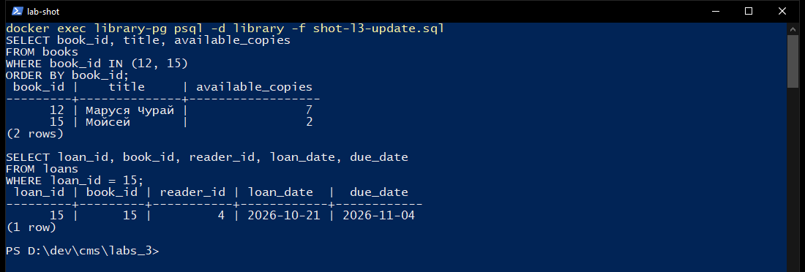
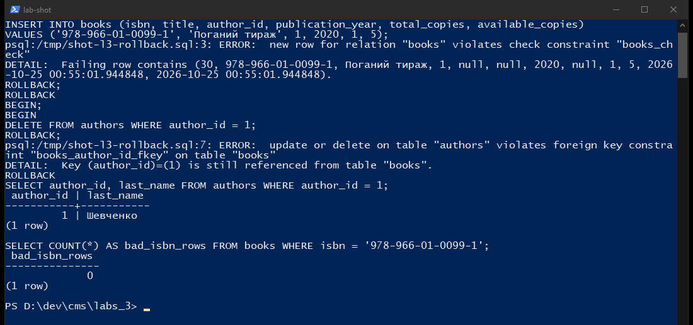
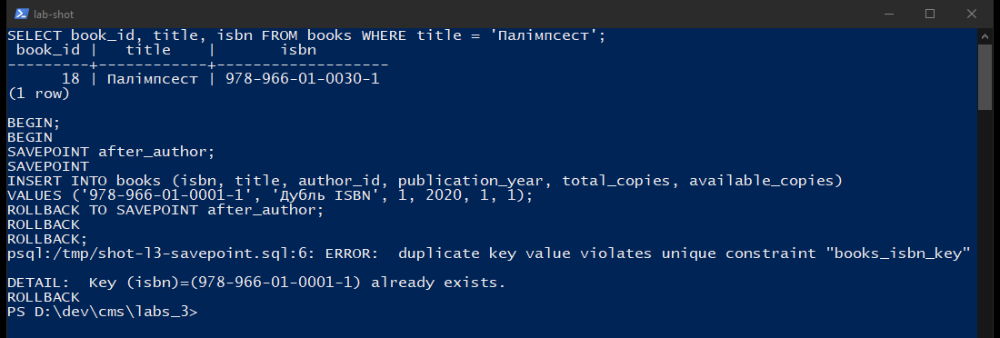
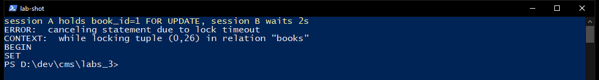
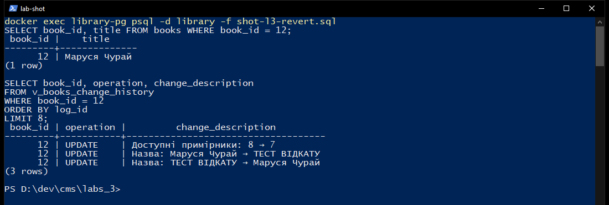
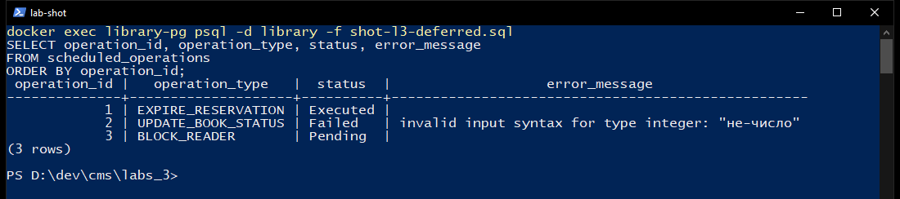
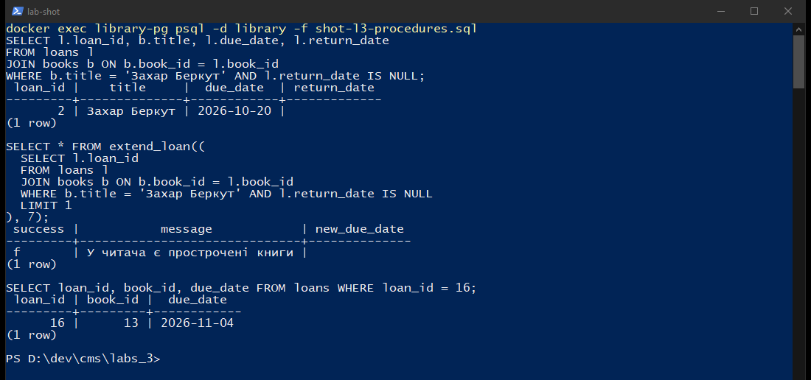
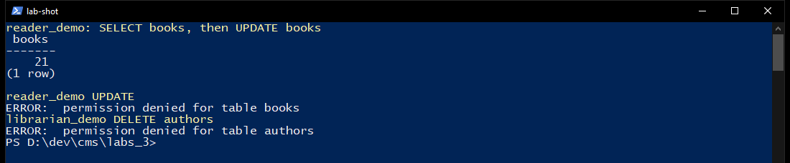
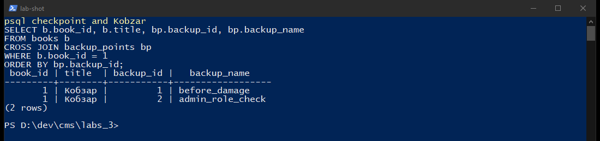
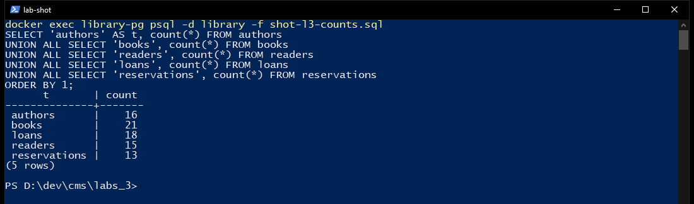

# Звіт з лабораторної роботи №3

**Тема:** Модифікація даних та транзакції  
**Виконав:** Пінкевич Артем Романович  
**Група:** ІПЗ-32  
**Навчальний заклад:** Волинський фаховий коледж Національного університету харчових технологій  
**Місто:** Луцьк, 2026  
**Рівень:** 3 (високий)

## Мета роботи

Навчитися безпечно змінювати дані в PostgreSQL: обмеження цілісності, `INSERT` / `UPDATE` / `DELETE`, транзакції з `COMMIT` і `ROLLBACK`, `SAVEPOINT`, каскади, тригери, блокування рядків, версії записів, відкладені операції, процедури, ролі та відновлення з контрольної точки.

## Середовище

Один контейнер `library-pg`, образ `postgres:16`, порт `5432`, база `library`, користувач `postgres`, пароль `postgres`. Сервер відповів:

`PostgreSQL 16.15 (Debian 16.15-1.pgdg13+2) on x86_64-pc-linux-gnu`

Скрипти лежать у `Lab03_SQL/`. Після цієї роботи в тій самій базі виконано лабораторні 4 і 5, тому частину лічильників нижче зафіксовано одразу після сценаріїв лабораторної 3, до додаткових книг лабораторної 4.

## Рівень 1. Таблиці, зміни і транзакції

Створено `genres`, `publishers`, `authors`, `books`, `readers`, `loans`. Для кожної таблиці задано первинний ключ. ISBN, email і номер квитка унікальні. Рік народження, рік видання, тираж і дати видачі перевіряються через `CHECK`. Автор книги видаляється з `ON DELETE RESTRICT`, видавництво і жанр - з `ON DELETE SET NULL`.

Початкове наповнення: 10 жанрів, 10 видавництв, 12 авторів, 15 книг, 13 читачів (один зі статусом `Inactive`), 14 видач і 11 бронювань. Після демонстрацій і відкату контрольної точки лічильники такі:

| Таблиця | Рядків |
| --- | ---: |
| authors | 13 |
| publishers | 10 |
| genres | 10 |
| books | 16 |
| readers | 12 |
| loans | 16 |
| reservations | 11 |

Неактивного читача Павленко (`LIB-2026-099`) видалено, бо в нього не було відкритих видач. Василь Стус і книга «Палімпсест» додані в сценарії `SAVEPOINT` і лишилися після `COMMIT`.

Безпечне оновлення: перед зміною прочитано «Марусю Чурай», потім один примірник списано на реставрацію.

```sql
UPDATE books
SET available_copies = available_copies - 1
WHERE book_id = 12 AND available_copies > 0
RETURNING book_id, title, available_copies;
```

Результат: `available_copies` змінилося з 8 на 7.



Видача «Мойсея» читачу Мельник виконана однією транзакцією: `INSERT` у `loans` (`loan_id` 15, повернути до 2026-11-04) і зменшення залишку до 2. Транзакцію закрито командою `COMMIT`.

Дві помилки відкочено. Вставка книги з `available_copies = 5` при `total_copies = 1` отримала:

`ERROR: new row for relation "books" violates check constraint "books_check"`

Видалення Шевченка (`author_id = 1`) отримало:

`ERROR: update or delete on table "authors" violates foreign key constraint "books_author_id_fkey"`

Після `ROLLBACK` рядок автора 1 на місці, а ISBN `978-966-01-0099-1` у таблиці немає.



## Рівень 2. Бронювання, SAVEPOINT, каскад, тригери, блокування

Таблиці `reservations` і `audit_log` створені разом зі схемою. Бронювання посилається на книгу і читача з `ON DELETE CASCADE`.

`SAVEPOINT` перевірено в одній транзакції. Після автора Стуса (`author_id` 13) вставлено книгу з уже зайнятим ISBN `978-966-01-0001-1`. Сервер повернув:

`ERROR: duplicate key value violates unique constraint "books_isbn_key"`

`ROLLBACK TO SAVEPOINT after_author` скасував лише цю вставку. Наступний `INSERT` з ISBN `978-966-01-0030-1` записав «Палімпсест», `book_id` 18. `COMMIT` залишив і автора, і книгу.



Окремо додано тестового автора, книгу `978-966-00-0099-9` і бронювання. `DELETE FROM books WHERE isbn = '978-966-00-0099-9'` прибрав і книгу, і бронювання. Запит сирітських бронювань повернув 0. Тестового автора після цього видалено, бо книг у нього вже не було.

Тригер `books_audit_trigger` пише `INSERT`, `UPDATE` і `DELETE` у `audit_log` (`old_data`, `new_data`, `changed_by`). Тригер `book_versioning_trigger` закриває попередню версію і додає новий JSON-знімок у `books_versions`. Оновлення сторінок «Лісової пісні» з 144 на 146 створило і запис аудиту, і нову версію.

Блокування перевірено двома сесіями `psql`. Перша виконала `SELECT ... FROM books WHERE book_id = 1 FOR UPDATE` і `pg_sleep(8)`. Друга з `lock_timeout = '2s'` отримала:

`ERROR: canceling statement due to lock timeout`  
`CONTEXT: while locking tuple (0,26) in relation "books"`

Після `COMMIT` першої сесії те саме блокування пройшло і повернуло «Кобзар», 9 доступних примірників.



## Рівень 3. Версії, відкладені дії, процедури, ролі, відновлення

### Версії і відкат через представлення

Для книги 12 збережено три версії. Назву змінено на `ТЕСТ ВІДКАТУ`, потім `revert_book_to_version(12, 1)` повернув описові поля. Тираж функція не чіпає: його тримають відкриті видачі. Після відкату назва знову «Маруся Чурай». Представлення `v_books_change_history` показало три рядки: `8 → 7`, зміна назви на тестову і повернення. `get_changes_report` за поточну добу порахував 9 змін: 2 вставки, 6 оновлень, 1 видалення.



### Відкладені операції

`execute_scheduled_operations()` обробила чергу і повернула `executed_now = 1`.

| operation_id | Тип | Статус | Помилка |
| ---: | --- | --- | --- |
| 1 | EXPIRE_RESERVATION | Executed | - |
| 2 | UPDATE_BOOK_STATUS | Failed | `invalid input syntax for type integer: "не-число"` |
| 3 | BLOCK_READER | Pending | заплановано на 2 дні вперед |

Бронювання 1 після виконання процедури має статус `Expired`. Майбутнє блокування читача 12 не виконувалось.



### Процедури

`extend_loan` для відкритої видачі «Захар Беркут» повернула `success = f` і текст «У читача є прострочені книги» (термін був 2026-10-20). Для «Лісової пісні» та сама функція повернула `success = t`, новий термін `2026-11-06`.

`issue_loan(13, 8, 14)` видала «Intermezzo», `loan_id` 16, залишок 3 з 4.

У транзакції читача 6 переведено в `Blocked`. `issue_loan` відмовила: «Читач не має статусу Active». `ROLLBACK` повернув статус `Active`.



### Ролі

Створено ролі `role_library_admin`, `role_librarian`, `role_reader` і користувачів `admin_demo`, `librarian_demo`, `reader_demo`. Паролі навчальні: `admin_pass`, `librarian_pass`, `reader_pass`.

Підключення йшло через TCP (`-h 127.0.0.1`), тобто пароль справді перевірявся. `reader_demo` прочитав 16 книг. `UPDATE books` від його імені отримав `permission denied for table books`. `librarian_demo` не зміг видалити автора: `permission denied for table authors`. Адміністратор зміг викликати `create_backup_point`: функція повернула `backup_id` 2.



### Контрольна точка

`create_backup_point('before_damage', ...)` зберіг JSON-знімок жанрів, видавництв, авторів, книг, читачів, видач і бронювань (`backup_id` 1). Назву книги 1 змінено на `ПОШКОДЖЕНА НАЗВА`. `restore_from_backup(1)` повернула `t`. Назва знову «Кобзар». Під час відновлення користувацькі тригери вимикаються, таблиці очищаються і заповнюються зі знімка, послідовності виставляються на `MAX(id)`. Після відновлення лічильники: 13 авторів, 16 книг, 12 читачів, 16 видач, 11 бронювань, 1 контрольна точка на момент цього запиту. Другу точку вже після цього створив `admin_demo`.





Таблиця вище зафіксована одразу після лабораторної 3. Знімок екрана зроблено пізніше, коли в тій самій базі вже були дані лабораторних 4 і 5: 16 авторів, 21 книга, 15 читачів, 18 видач, 13 бронювань.

## Висновки

Обмеження `CHECK` і зовнішні ключі зупиняють некоректну вставку та видалення автора, у якого є книги. `COMMIT` фіксує видачу разом зі зміною залишку, `ROLLBACK` і `SAVEPOINT` скасовують відповідно всю транзакцію або лише помилковий ISBN. Каскад прибирає бронювання разом із книгою, а `RESTRICT` захищає авторів і видачі. Тригери ведуть аудит і версії, представлення показує історію, а процедура відновлює описові поля. Відкладена черга відрізняє виконану, зіпсовану і майбутню операцію. Ролі розділяють читання, роботу бібліотекаря і адміністратора. JSON-знімок повернув назву «Кобзар» після навмисного пошкодження.

Повний SQL: `Lab03_SQL/01_schema.sql` … `Lab03_SQL/10_checkpoint.sql`.
