# Звіт з лабораторної роботи №5

**Тема:** Керування базою, індекси і автоматизація  
**Виконав:** Пінкевич Артем Романович  
**Група:** ІПЗ-32  
**Навчальний заклад:** Волинський фаховий коледж Національного університету харчових технологій  
**Місто:** Луцьк, 2026  
**Рівень:** 3 (високий)

## Мета роботи

На базі бібліотеки з лабораторних 3 і 4 порівняти плани `EXPLAIN (ANALYZE, BUFFERS)`, додати індекси, представлення, журнал, обмеженого користувача, оновлюване представлення, часткові індекси, копію `pg_dump`, матеріалізоване представлення, каскад тригерів, ієрархію ролей, процедуру обслуговування і моніторинг.

Контейнер той самий: `library-pg`, PostgreSQL **16.15**. Розширення `pg_stat_statements` увімкнене через `shared_preload_libraries` під час запуску контейнера.

Щоб план змінився, у `circulation_facts` завантажено **100 000** рядків (події `loan`, `return`, `overdue`, `fine` за 2022–2025 роки). `SELECT COUNT(*)` після завантаження підтвердив це число. Мала таблиця з 21 книги для такого досліду не підходить: оптимізатор лишає послідовне сканування.

## Рівень 1. Плани, індекси, представлення, журнал, обмежений користувач

Три запити з `Lab05_SQL/02_queries.sql` спочатку виконано без індексів на `circulation_facts`, потім створено три індекси і запити повторено.

| Запит | До | Після | Час до, мс | Час після, мс | Скорочення |
| --- | --- | --- | ---: | ---: | ---: |
| Q1. Події книги за 2024-06-01 | Seq Scan, відкинуто 99976 рядків, знайдено 24 | Bitmap Index Scan `idx_circ_book_date` | 12.956 | 0.128 | 99.0% |
| Q2. `event_type = overdue` і `fee = 7`, `LIMIT 25` | Seq Scan, 556 збігів | Index Scan `idx_circ_type_fee_date` | 9.170 | 0.248 | 97.3% |
| Q3. Сума за 2023-06-15 | Seq Scan, 72 рядки | Bitmap Index Scan `idx_circ_event_date` | 5.468 | 0.533 | 90.3% |

Індекси:

```sql
CREATE INDEX idx_circ_book_date ON circulation_facts (book_id, event_date);
CREATE INDEX idx_circ_type_fee_date ON circulation_facts (event_type, fee, event_date DESC);
CREATE INDEX idx_circ_event_date ON circulation_facts (event_date);
ANALYZE circulation_facts;
```

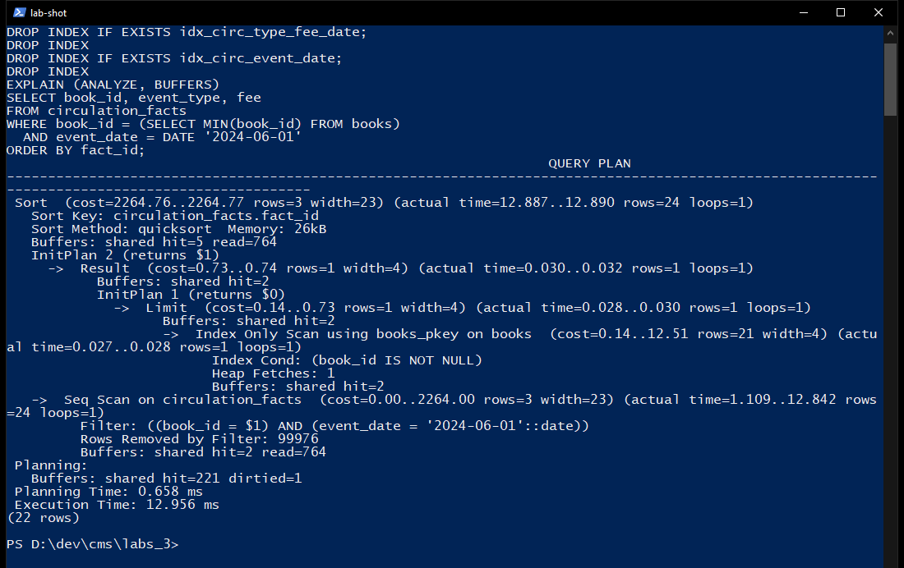

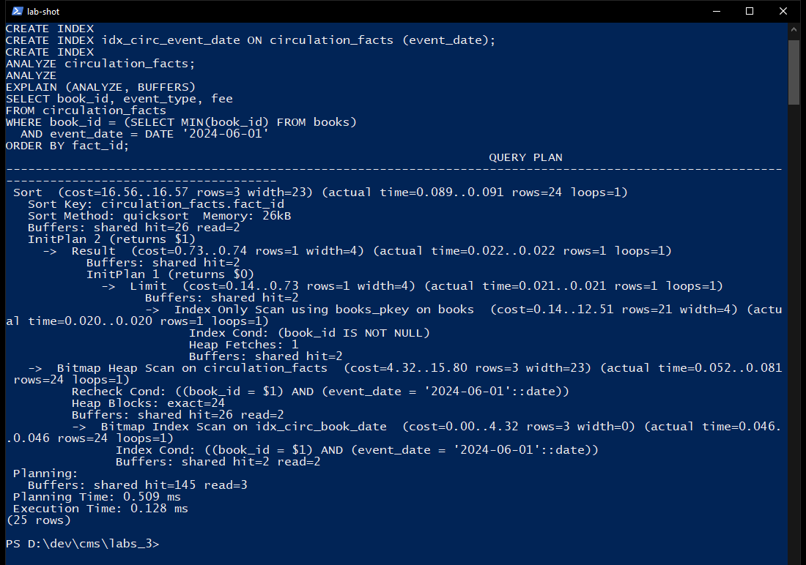

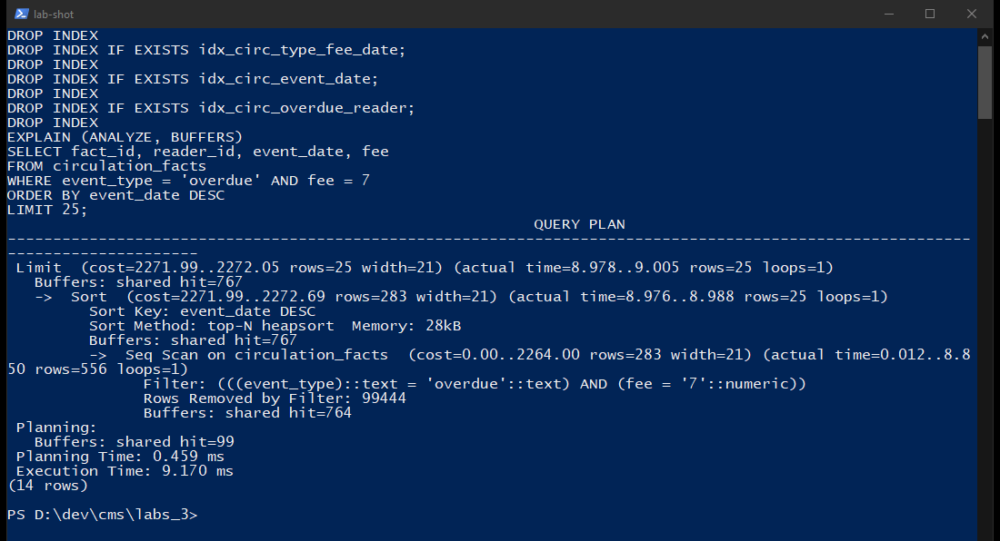

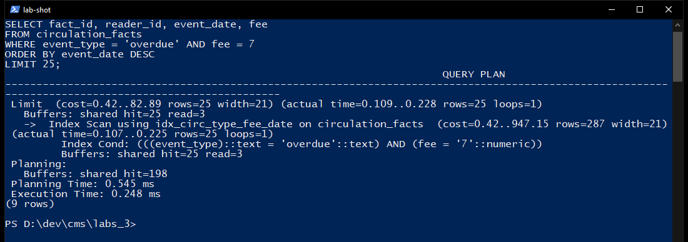

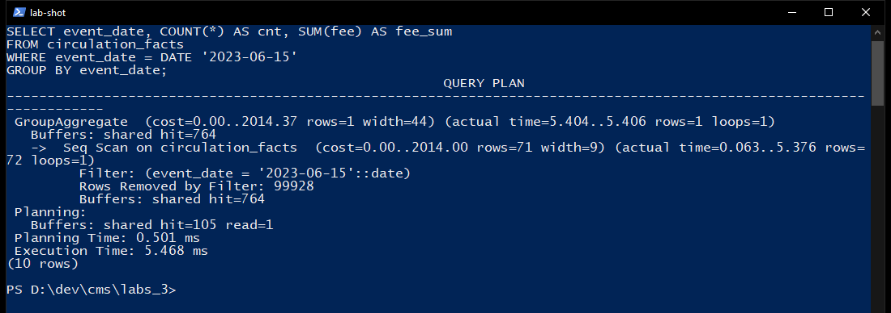

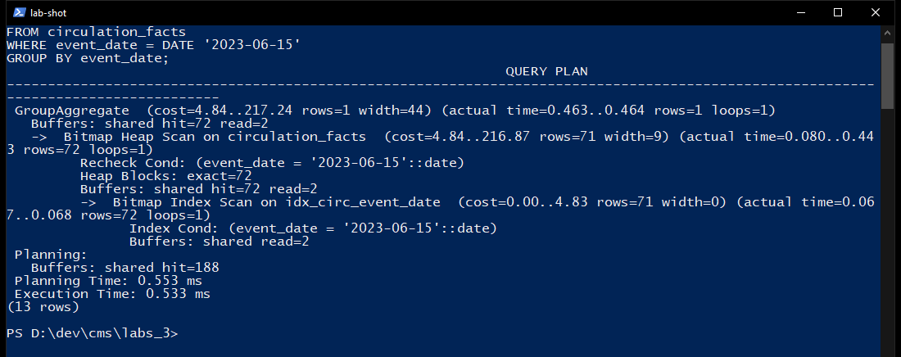

Представлення `v_overdue_loans` бере прострочені рядки з `v_active_loans`. `v_reader_loan_stats` рахує видачі, відкриті й прострочені по кожному читачу.

Журнал `audit_log` уже був у лабораторній 3. У лабораторній 5 функція `comprehensive_audit_log()` пише операцію, таблицю, час, користувача, старі й нові значення для `readers` і `loans`. Поле ключа береться з JSON рядка (`reader_id` або `loan_id`): пряме звернення `NEW.loan_id` у тригері читачів падало з `record "new" has no field "loan_id"`. Простіший тригер видач лабораторної 4 знято, щоб не було подвійного запису.

`report_viewer` / `report_pass` має `SELECT` на каталог і довідники. `SELECT count(*) FROM v_books_catalog` повернув 21. `INSERT` у `books` отримав `permission denied for table books`.

## Рівень 2. Оновлюване представлення, валідація, часткові індекси, копія

`v_reader_contacts` показує читачів, крім `Inactive`. Правило `v_reader_contacts_update` на `UPDATE` виконує `INSTEAD` оновлення `email`, `phone` і `status` у `readers`. Після правила телефон читача 1 знову `+380501234567` (його змінювали в тесті журналу і повернули).

Тригер `trg_validate_reader` спрацьовує до вставки і відхиляє дані. Повідомлення сервера:

`Відхилено: Некоректний email: not-an-email`  
`Відхилено: Некоректний телефон (очікується +380 і 9 цифр): 0501112233`

Обидва рядки з картками `LIB-ERR-1` і `LIB-ERR-2` у таблиці не залишилися: виняток відкотив блок.

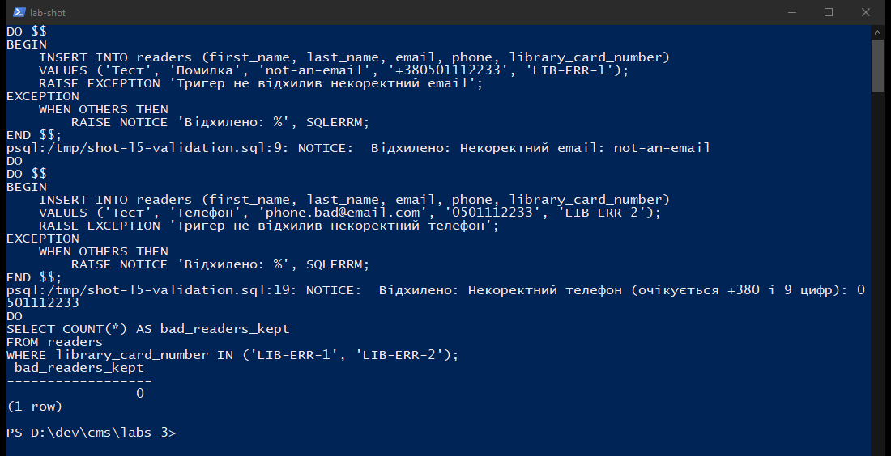

Часткові індекси:

```sql
CREATE INDEX idx_circ_overdue_reader
    ON circulation_facts (reader_id, event_date)
    WHERE event_type = 'overdue';

CREATE INDEX idx_loans_open_due
    ON loans (due_date)
    WHERE return_date IS NULL;
```

Запит прострочень одного читача до часткового індексу читав `idx_circ_type_fee_date`: Bitmap Heap Scan, 25 000 рядків індексу, фільтр відкинув 22 619, лишилося 2381, **6.791 мс**. Після часткового індексу план став Index Only Scan `idx_circ_overdue_reader`, ті самі 2381 рядки, **0.476 мс** (скорочення 93.0%). Heap Fetches = 0.

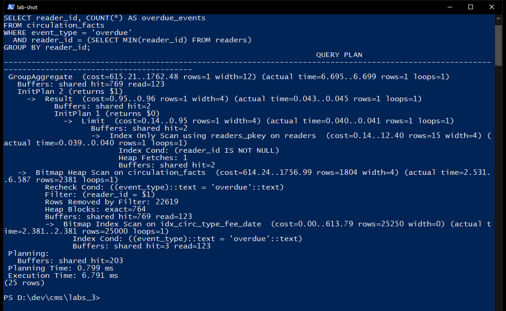

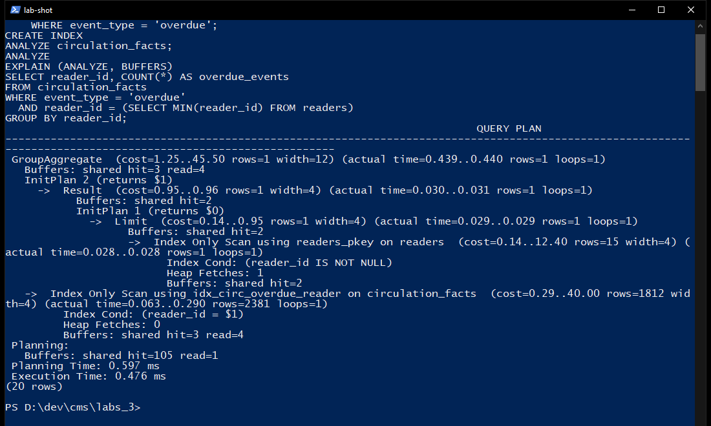

`Lab05_SQL/backup_restore.ps1` зняв дамп `pg_dump --no-owner --no-privileges` і відновив його в нову базу `library_restore` на тому самому сервері. Файл `Lab05_SQL/backups/library_full.sql` має **3 530 034 байти**. Після відновлення:

| Таблиця | Рядків у library_restore |
| --- | ---: |
| books | 21 |
| loans | 17 |
| circulation_facts | 100000 |

Дамп знято до вебперевірки лабораторної 4. Після неї в живій базі з'явилася і була повернена видача `loan_id` 18, тому зараз у `library` 18 рядків `loans`, з них 11 відкритих. Копія `library_restore` зберігає стан на момент `pg_dump`.

## Рівень 3. Матеріалізоване представлення, каскад, ролі, обслуговування, моніторинг

`mv_genre_summary` рахує книги і примірники за жанром. Унікальний індекс на `genre_id`. Тригер `trg_refresh_genre_summary` після оператора над `books` виконує `REFRESH MATERIALIZED VIEW` без `CONCURRENTLY`: варіант `CONCURRENTLY` у PostgreSQL не працює всередині транзакції тригера. Для жанру «Роман» представлення показало 10 книг і 35 доступних примірників. Після `total_copies + 1` і `available_copies + 1` у «Соборі» доступних стало 36. Зворотне оновлення повернуло тираж. У `maintenance_log` два рядки `refresh mv_genre_summary` / `UPDATE ON books`.

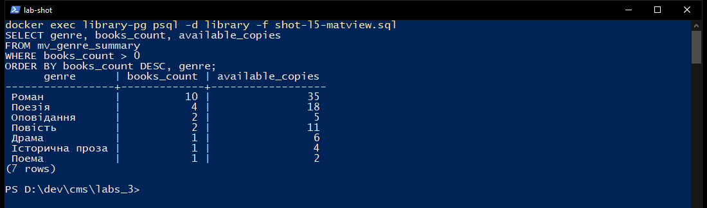

Каскад тригерів: `AFTER UPDATE OF status` на `readers`, якщо статус став `Blocked`, скасовує активні бронювання. Другий тригер на `reservations` пише подію `cancelled` у `reservation_events`. Для читача `LIB-CASCADE-1` (`reader_id` 17) сервер показав статус `Blocked`, бронювання 13 зі статусом `Cancelled` і подію `event_id` 1.

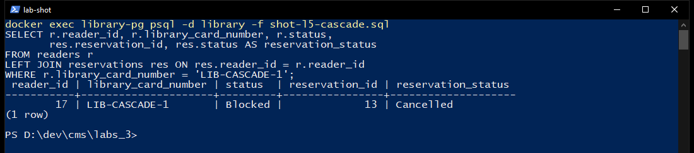

Ієрархія: `role_user` → `role_moderator` → `role_admin`. Користувачі `user_demo`, `moderator_demo`, `admin_l5`. `user_demo` прочитав 21 книгу і не зміг вставити книгу (`permission denied for table books`). Перший `UPDATE books` від модератора впав: тригер версій пише в `books_versions`, а права на цю таблицю модератору не давали (`permission denied for table books_versions`). Функції тригерів переведено на `SECURITY DEFINER` з `search_path = public` (`Lab05_SQL/14_security_definer.sql`). Повторний `UPDATE` повернув `book_id` 1, «Кобзар», 352 сторінки.

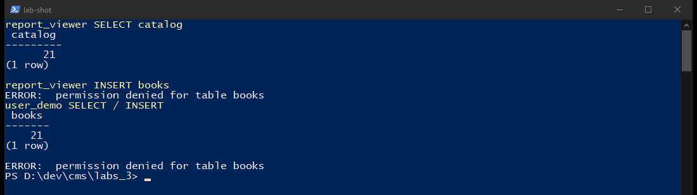

Процедура `maintain_database()` виконує `ANALYZE`, потім у циклі `REINDEX TABLE` кожної таблиці `public` і `COMMIT` між таблицями. `VACUUM` і `REINDEX DATABASE` всередину процедури не ставив: PostgreSQL їх у цьому контексті не виконує. Виклик `CALL maintain_database()` записав `ANALYZE + REINDEX`, `tables=16`, час `2026-10-25 00:57:11`.

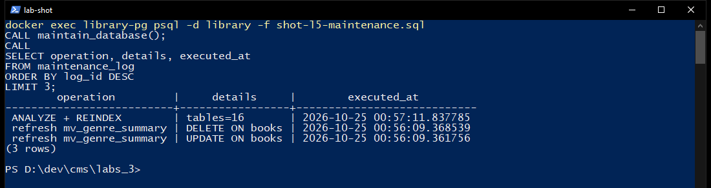

`Lab05_SQL/13_monitoring.sql` читає `pg_stat_user_indexes`, `pg_stat_statements` і `pg_stat_user_tables`.

Найповільніші оператори на момент зняття:

| Викликів | Середній час, мс | Запит |
| ---: | ---: | --- |
| 4 | 8006.61 | `SELECT pg_sleep($1)` (утримання блокування) |
| 1 | 1385.96 | анонімний блок завантаження `circulation_facts` |
| 1 | 1382.89 | `INSERT INTO circulation_facts` |
| 2 | 811.40 | `CALL maintain_database()` |
| 2 | 386.22 | `REINDEX TABLE public.circulation_facts` |

`circulation_facts`: `n_live_tup = 100000`, `seq_scan = 34`, `idx_scan = 5`. У `books` лічильник `seq_scan` дорівнює 100171: під час масової вставки перевірка зовнішнього ключа багато разів послідовно читала маленьку батьківську таблицю. Після `ANALYZE` вибірки з `circulation_facts` уже йдуть через індекси, що видно в планах вище. Невикористані індекси (наприклад `idx_books_title`, `idx_loans_open_due`) у звіті моніторингу теж є: на поточному обсязі довідників оптимізатор їх не чіпав. Їх не видаляв, бо каталог і відкриті видачі зростатимуть.

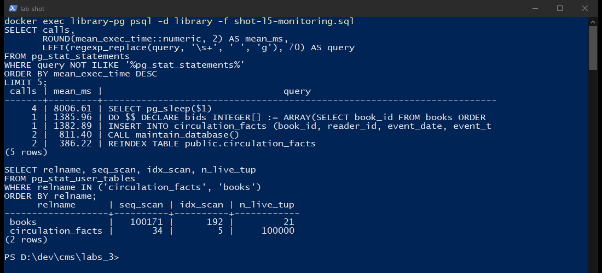

## Висновки

На 100 000 подій три індекси замінили Seq Scan на Bitmap Index Scan або Index Scan і скоротили час трьох запитів на 90–98%. Частковий індекс прострочень дав Index Only Scan замість відбору 25 000 рядків із ширшого індексу. Представлення спрощують прострочення і статистику читачів, правило `INSTEAD` оновлює контакти, тригер не пускає поганий email і телефон. `pg_dump` відновився в `library_restore` з тими самими 21 книгою, 17 видачами і 100 000 подіями. Матеріалізоване представлення оновлює тригер, блокування читача скасовує бронювання і пише подію, процедура перебудовує 16 таблиць, а `pg_stat_statements` показує, що найдорожчими були завантаження, `pg_sleep` і `REINDEX`, а не пошук по індексу.

Скрипти: `Lab05_SQL/01_bulk.sql` … `Lab05_SQL/14_security_definer.sql` і `Lab05_SQL/backup_restore.ps1`. Контейнер `library-pg` після роботи залишено запущеним.
